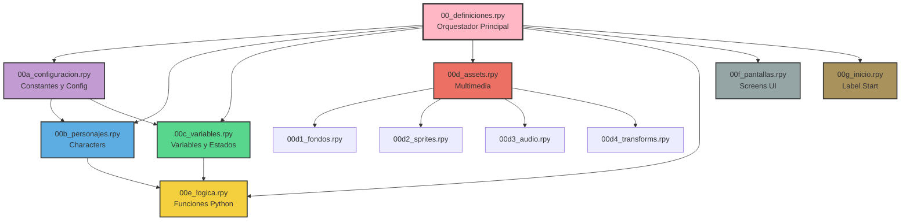
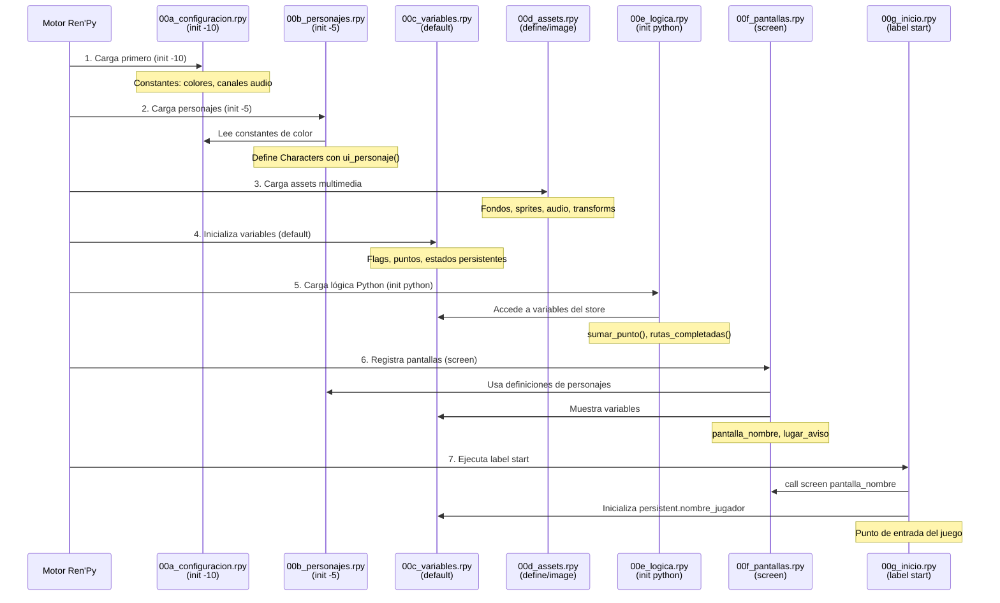
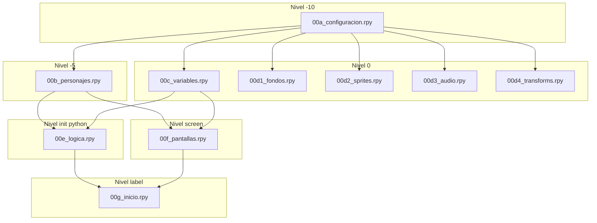

# Design Document: Modularización de 00_definiciones.rpy

## Overview

Este diseño proporciona una arquitectura modular para reorganizar el archivo monolítico `00_definiciones.rpy` en múltiples archivos especializados, mejorando la mantenibilidad, escalabilidad y claridad del código del proyecto "The Fifth Choice" (Ren'Py 8.5.3).

El archivo actual contiene 11 secciones diferentes (personajes, variables, fondos, sprites, audio, etc.) en un único archivo de ~600 líneas. La modularización separará estas responsabilidades en archivos dedicados con nombres descriptivos y una jerarquía clara, siguiendo las convenciones de Ren'Py para el orden de inicialización.

## Architecture

La arquitectura propuesta organiza las definiciones en una estructura de tres niveles con dependencias explícitas:



**Niveles de Arquitectura:**

1. **Nivel Orquestador** (`00_definiciones.rpy`): Archivo mínimo que importa todos los módulos
2. **Nivel Principal** (`00a_` a `00g_`): Módulos de responsabilidad única
3. **Nivel Submódulos** (`00d1_` a `00d4_`): Descomposición de assets multimedia

## Sequence Diagram: Orden de Carga en Ren'Py



## Components and Interfaces

### Component 1: 00_definiciones.rpy (Orquestador)

**Purpose**: Archivo de entrada principal que importa todos los módulos. Mantiene compatibilidad con el código existente.

**Interface**:
```python
# Archivo orquestador mínimo
# Solo contiene comentarios y metadatos del proyecto
# No contiene lógica ejecutable
```

**Responsibilities**:
- Servir como punto de entrada reconocido por Ren'Py
- Documentar la estructura modular del proyecto
- Mantener compatibilidad con referencias existentes a `00_definiciones.rpy`

**Dependencies**: Todos los módulos (00a_ a 00g_)

---

### Component 2: 00a_configuracion.rpy

**Purpose**: Constantes globales y configuración de bajo nivel del sistema (colores, canales de audio, constantes de UI).

**Interface**:
```python
init -10 python:
    # Prioridad -10: se carga ANTES que personajes y assets
    
    # CONSTANTES DE COLOR (usadas en definiciones de Character)
    C_ICHIKA: str = "#FFB7C5"
    C_NINO: str = "#C39BD3"
    C_MIKU: str = "#5DADE2"
    C_YOTSUBA: str = "#58D68D"
    C_ITSUKI: str = "#EC7063"
    
    # CONSTANTES DE POSICIONES (formación de cinco hermanas)
    X_ICHIKA: float = 0.10
    X_NINO: float = 0.30
    X_MIKU: float = 0.50
    X_YOTSUBA: float = 0.70
    X_ITSUKI: float = 0.90
    
    # CONFIGURACIÓN DE CANALES DE AUDIO
    # Registra el canal "ambiente" en el mezclador de música
    renpy.music.register_channel("ambiente", "music", loop=True)
    renpy.music.set_volume(1.0, channel="music")
```

**Responsibilities**:
- Definir todas las constantes de color para personajes
- Definir constantes de posicionamiento para sprites
- Registrar canales de audio personalizados (`ambiente`)
- Configurar volúmenes iniciales de audio
- Proporcionar valores inmutables usados por otros módulos

**Validation Rules**:
- Los colores deben ser strings hexadecimales válidos (#RRGGBB)
- Las posiciones deben estar en el rango [0.0, 1.0]
- Los canales de audio deben registrarse antes de ser usados

---

### Component 3: 00b_personajes.rpy

**Purpose**: Definiciones de todos los objetos `Character` de Ren'Py (protagonista, quintillizas, secundarios, narradores).

**Interface**:
```python
init -5 python:
    # Prioridad -5: carga después de configuración, antes de variables
    # Requiere: ui_personaje(), ui_interior() de 07_ui.rpy
    
    # PROTAGONISTA
    mc: Character               # Diálogos del protagonista
    mc_pensamiento: Character   # Pensamientos (libreta)
    narrador: Character         # Narrador del proyecto (con "d")
    narrator: Character         # Narrador interno de Ren'Py (sin "d")
    profe: Character            # Profesor (caja de narrador con placa)
    
    # QUINTILLIZAS
    ichika: Character
    nino: Character
    miku: Character
    yotsuba: Character
    itsuki: Character
    itsuki_inicio: Character    # "Estudiante Nueva" (sin pétalo)
    quintillizas: Character     # Las cinco a la vez
    voz: Character              # Voz misteriosa ("???")
    
    # VOCES INTERIORES (Evento 6)
    ichika_int: Character
    nino_int: Character
    miku_int: Character
    yotsuba_int: Character
    itsuki_int: Character
    
    # SECUNDARIOS
    isanari: Character          # Padre del protagonista
    raiha: Character            # Hermana del protagonista
    maruo: Character            # Padre de las quintillizas
```

**Responsibilities**:
- Instanciar todos los objetos `Character` del juego
- Configurar estilos de caja de texto (window_background, what_color)
- Asignar decoraciones de pétalos (show_tipo, show_placa)
- Vincular colores desde `00a_configuracion.rpy`
- Usar funciones helper de `07_ui.rpy` (ui_personaje, ui_interior)

**Design Decisions**:
- `narrator` (sin "d") se define igual que `narrador` para que las transiciones vacías y los `menu:` usen el mismo estilo
- Los personajes interiores (`*_int`) no tienen placa de nombre, solo caja de color
- `itsuki_inicio` usa el mismo color pero sin decoración de pétalo

---

### Component 4: 00c_variables.rpy

**Purpose**: Todas las variables de estado del juego (flags, puntos, persistencia).

**Interface**:
```python
# VARIABLES DEL JUEGO (default = se inicializan al inicio)

# IDENTIDAD
default nombre_jugador: str = "Futaro"

# DECISIÓN FINAL (Capítulo 3)
default decision_hermana: Optional[str] = None
default decision_pistas: List[str] = ["calida", "tibia", "fria"]
default decision_titulo: str = ""
default decision_motivo: str = ""

# PUNTOS DE AFINIDAD (invisibles al jugador)
default puntos_ichika: int = 0
default puntos_nino: int = 0
default puntos_miku: int = 0
default puntos_yotsuba: int = 0
default puntos_itsuki: int = 0

# DESEMPATE
default primera_conexion: str = ""
default primera_decision_hecha: bool = False

# VISITAS A HUBS (Capítulo 1)
default ichika_visitada_cap1: bool = False
default nino_visitada_cap1: bool = False
default miku_visitada_cap1: bool = False
default yotsuba_visitada_cap1: bool = False
default itsuki_visitada_cap1: bool = False

# RAMAS ELEGIDAS EN HUBS
default ichika_rama_cap1: Optional[str] = None
default nino_rama_cap1: Optional[str] = None
default miku_rama_cap1: Optional[str] = None
default yotsuba_rama_cap1: Optional[str] = None
default itsuki_rama_cap1: Optional[str] = None

# ESTADOS DEL CAPÍTULO 1
default tiempo_restante: str = "casi cuatro semanas"
default maruo_ultimatum: bool = False
default despido_cap1: bool = False
default despido_en_beat: bool = False
default desaires_cap1: int = 0
default clima_cap1: str = "mixta"
default hub_visitadas: List[str] = []

# EVENTO 6 (cierre Capítulo 1)
default e6_estado_entrada: str = "mixto"
default e6_estado: Dict = {}
default e6_frase: Dict = {}
default e6_promesas: List[str] = []
default e6_notas: Dict = {}
default e6_mj: Dict = {}
default e6_puntos_ini: Dict = {}

# PERSISTENCIA (sobrevive entre partidas)
default persistent.nombre_jugador: str = ""
default persistent.ruta_ichika_completa: bool = False
default persistent.ruta_nino_completa: bool = False
default persistent.ruta_miku_completa: bool = False
default persistent.ruta_yotsuba_completa: bool = False
default persistent.ruta_itsuki_completa: bool = False
default persistent.final_secreto_desbloqueado: bool = False
default persistent.final_malo_visto: bool = False
default persistent.e6_mj_ganado_ichika: bool = False
default persistent.e6_mj_ganado_nino: bool = False
default persistent.e6_mj_ganado_miku: bool = False
default persistent.e6_mj_ganado_yotsuba: bool = False
default persistent.e6_mj_ganado_itsuki: bool = False
```

**Responsibilities**:
- Centralizar todas las variables de estado del juego
- Separar variables temporales (default) de persistentes (persistent)
- Agrupar por categoría: identidad, puntos, flags de progreso, estados de evento
- Documentar el propósito de cada grupo de variables

**Validation Rules**:
- Los puntos de afinidad nunca deben ser negativos
- Las variables persistentes deben tener valores por defecto conservadores
- Los diccionarios vacíos (`e6_estado`, etc.) se inicializan en tiempo de ejecución

---

### Component 5: 00d_assets.rpy (Orquestador de Assets)

**Purpose**: Archivo orquestador que importa todos los submódulos de multimedia.

**Interface**:
```python
# Este archivo solo contiene comentarios
# Los assets reales están en:
#   - 00d1_fondos.rpy
#   - 00d2_sprites.rpy
#   - 00d3_audio.rpy
#   - 00d4_transforms.rpy
```

**Responsibilities**:
- Documentar la estructura de submódulos de assets
- Proporcionar un punto de referencia único para multimedia
- Facilitar el descubrimiento de assets por tipo

**Dependencies**: 00d1_, 00d2_, 00d3_, 00d4_

---

### Component 6: 00d1_fondos.rpy

**Purpose**: Definiciones de fondos (backgrounds) y CG compartidos.

**Interface**:
```python
# FONDOS BG
image bg_cuarto_mc: str = "bg/cuarto_mc.webp"
image bg_comedor: str = "bg/comedor.webp"
image bg_escuela: str = "bg/escuela.webp"
image bg_aula: str = "bg/aula_mañana.webp"
image bg_azotea_tarde: str = "bg/azotea_tarde.webp"
image bg_edificio: str = "bg/edificio.webp"
image bg_entrada_edificio: str = "bg/entrada_edificio.webp"
image bg_departamento: str = "bg/departamento.webp"
image bg_departamento_anochecer: str = "bg/departamento_anochecer.webp"
image bg_negro: Solid = Solid("#000000")

# CG COMPARTIDOS (usados en múltiples capítulos)
image cg_calificacion: str = "cg/calificacion.webp"
image cg_maruo_reunion: str = "cg/maruo_umbral.webp"
image cg_hermanas_estudiando: str = "cg/estudio_hermanas.webp"
image cg_cinco_estudiando: str = "cg/cinco_estudiando.webp"
image cg_cinco_repasando: str = "cg/cinco_repasando.webp"
```

**Responsibilities**:
- Declarar todos los fondos reutilizables del proyecto
- Declarar CG compartidos entre múltiples capítulos
- Seguir convención de nombres: `bg_*` para fondos, `cg_*` para ilustraciones

**Design Decisions**:
- Los CG específicos de un capítulo se definen en el archivo de ese capítulo
- Un CG "sube" a este archivo cuando se reutiliza en un segundo capítulo
- `bg_negro` usa `Solid()` en lugar de archivo para ahorrar memoria

---

### Component 7: 00d2_sprites.rpy

**Purpose**: Definiciones de sprites de personajes (expresiones, poses).

**Interface**:
```python
# SPRITES PROTAGONISTA
# (Comentado hasta que el asset esté disponible)
# image futaro_silueta: str = "sprites/futaro_silueta.webp"

# SPRITES SECUNDARIOS
image raiha hablando: str = "sprites/raiha_sprites/raiha_hablando.png"
image raiha regano: str = "sprites/raiha_sprites/raiha_regano.png"
image raiha preocupada: str = "sprites/raiha_sprites/raiha_preocupada.png"

image isanari neutral: str = "sprites/isanari_sprites/isanari_neutral.png"
image isanari sonriendo: str = "sprites/isanari_sprites/isanari_sonrisa.png"

# SPRITES QUINTILLIZAS
image itsuki neutral: str = "sprites/itsuki_sprites/itsuki_neutral.png"
image itsuki sonriendo: str = "sprites/itsuki_sprites/itsuki_sonriendo.png"
image itsuki molesta: str = "sprites/itsuki_sprites/itsuki_molesta.png"
image itsuki sorprendida: str = "sprites/itsuki_sprites/itsuki_sorprendida.png"
image itsuki timida: str = "sprites/itsuki_sprites/itsuki_timida.png"

image ichika neutral: str = "sprites/ichika_sprites/ichika_neutral.png"
image ichika sonriendo: str = "sprites/ichika_sprites/ichika_sonriendo.png"
image ichika agotada: str = "sprites/ichika_sprites/ichika_agotada.png"
image ichika determinada: str = "sprites/ichika_sprites/ichika_determinada.png"

image nino neutral: str = "sprites/nino_sprites/nino_neutral.png"
image nino pillada: str = "sprites/nino_sprites/nino_pillada.png"
image nino nerviosa: str = "sprites/nino_sprites/nino_nerviosa.png"
image nino molesta: str = "sprites/nino_sprites/nino_molesta.png"

image miku neutral: str = "sprites/miku_sprites/miku_neutral.png"
image miku animada: str = "sprites/miku_sprites/miku_animada.png"
image miku relajada: str = "sprites/miku_sprites/miku_relajada.png"
image miku encogida: str = "sprites/miku_sprites/miku_encogida.png"

image yotsuba neutral: str = "sprites/yotsuba_sprites/yotsuba_neutral.png"
image yotsuba sonriendo: str = "sprites/yotsuba_sprites/yotsuba_sonriendo.png"
image yotsuba incomoda: str = "sprites/yotsuba_sprites/yotsuba_incomoda.png"
image yotsuba sorprendida: str = "sprites/yotsuba_sprites/yotsuba_sorprendida.png"
```

**Responsibilities**:
- Centralizar todas las definiciones de sprites
- Mantener convención de nombres: `[personaje] [expresion]`
- Organizar sprites en secciones por personaje
- Documentar assets pendientes (comentados hasta tener el archivo)

**Validation Rules**:
- Cada sprite debe seguir el formato: `image [nombre] [estado] = "ruta"`
- Los archivos deben existir en el sistema para que Ren'Py compile
- Los sprites comentados deben incluir nota explicativa

---

### Component 8: 00d3_audio.rpy

**Purpose**: Definiciones de música, ambiente y efectos de sonido.

**Interface**:
```python
# MÚSICA (BGM)
define audio.hogar: str = "audio/bgm/hogar.ogg"
define audio.cena: str = "audio/bgm/cena.ogg"
define audio.cotidiano: str = "audio/bgm/cotidiano.ogg"
define audio.incomodo: str = "audio/bgm/incomodo.ogg"
define audio.extraneza: str = "audio/bgm/extraneza.ogg"
define audio.caos: str = "audio/bgm/caos.ogg"
define audio.contrato: str = "audio/bgm/contrato.ogg"
define audio.derrota: str = "audio/bgm/derrota.ogg"
define audio.descubrimiento: str = "audio/bgm/descubrimiento.ogg"
define audio.hub: str = "audio/bgm/hub.ogg"

# TEMAS DE HERMANAS
define audio.itsuki: str = "audio/bgm/bgm_hermanas/itsuki_tema.ogg"
define audio.yotsuba: str = "audio/bgm/bgm_hermanas/yotsuba_tema.ogg"
define audio.miku: str = "audio/bgm/bgm_hermanas/miku_tema.ogg"
define audio.nino: str = "audio/bgm/bgm_hermanas/nino_tema.ogg"
define audio.ichika: str = "audio/bgm/bgm_hermanas/ichika_tema.ogg"

# AMBIENTE (en bucle)
define audio.amb_viento: str = "audio/amb_viento.ogg"
define audio.amb_silencio_exterior: str = "audio/silencio_exterior.ogg"
define audio.amb_reloj: str = "audio/amb_reloj.ogg"

# EFECTOS DE SONIDO (SFX)
define audio.sfx_papel_mesa: str = "audio/sfx/papel_mesa.mp3"
define audio.sfx_timbre: str = "audio/sfx/timbre.mp3"
define audio.sfx_silla: str = "audio/sfx/silla.mp3"
define audio.sfx_celular: str = "audio/sfx/celular.mp3"
define audio.sfx_toque_puerta: str = "audio/sfx/toque_puerta.mp3"
define audio.sfx_manija: str = "audio/sfx/manija.mp3"
define audio.sfx_puerta_abre: str = "audio/sfx/puerta_abre.mp3"
define audio.sfx_correr: str = "audio/sfx/correr.mp3"
define audio.sfx_portazo: str = "audio/sfx/portazo.mp3"
define audio.sfx_bolsa: str = "audio/sfx/bolsa.mp3"
define audio.sfx_hoja: str = "audio/sfx/hoja.mp3"
define audio.sfx_puerta_cierra: str = "audio/sfx/puerta_cierra.mp3"
define audio.sfx_pisadas_pista: str = "audio/sfx/pisadas_pista.ogg"

# EFECTOS DE INTERFAZ
define audio.sfx_hover: str = "audio/sfx/hover.mp3"
define audio.sfx_click: str = "audio/sfx/click.mp3"
define audio.sfx_hhover: str = "audio/sfx/hub_hover.mp3"
define audio.sfx_hclick: str = "audio/sfx/hub_click.mp3"
```

**Responsibilities**:
- Centralizar todas las definiciones de audio
- Organizar por categoría: música, ambiente, efectos, interfaz
- Mantener convención de nombres:
  - `audio.*` (sin prefijo): música general
  - `audio.amb_*`: ambiente en bucle
  - `audio.sfx_*`: efectos de sonido
- Documentar el propósito de pistas especiales (e.g., "hogar" solo suena 2 veces)

**Design Decisions**:
- El canal `ambiente` se registra en `00a_configuracion.rpy`, no aquí
- La función `duck()` se define en `00e_logica.rpy`, no aquí
- Los volúmenes se configuran en tiempo de ejecución, no en las definiciones

---

### Component 9: 00d4_transforms.rpy

**Purpose**: Transforms de ATL (Animation and Transformation Language) para posicionamiento y animación de sprites.

**Interface**:
```python
# TRANSFORMS DE POSICIONAMIENTO
transform pj(x=0.5):
    """Transform base: sprite en posición, sin tinte, zoom 1.0"""
    xanchor 0.5
    yanchor 1.0
    xpos x
    ypos 1.0
    zoom 1.0
    matrixcolor TintMatrix("#ffffff")

transform pj_habla(x=0.5):
    """Transform para personaje hablando: crece sutilmente, sin tinte"""
    xanchor 0.5
    yanchor 1.0
    xpos x
    ypos 1.0
    ease 0.25 zoom 1.01 matrixcolor TintMatrix("#ffffff")

transform pj_calla(x=0.5):
    """Transform para personaje callado: se encoge, tinte grisáceo"""
    xanchor 0.5
    yanchor 1.0
    xpos x
    ypos 1.0
    ease 0.25 zoom 0.99 matrixcolor TintMatrix("#a0a0a0")

# TRANSICIONES
define mover = MoveTransition(0.6)
define disolucion_lenta = Dissolve(0.4)
define fade_dia = Fade(0.7, 0.4, 0.7)
define corte_seco = Dissolve(0.1)
```

**Responsibilities**:
- Definir transforms reutilizables para sprites
- Implementar efectos de "habla" y "silencio" con zoom y tinte
- Definir transiciones temporales (fade, dissolve, move)
- SIEMPRE reafirmar posición absoluta en cada transform

**Design Decisions**:
- **Regla del Proyecto**: Todo `show` lleva su posición explícita
- Los desplazamientos van como `with mover`, no como `ease` dentro del transform
- Un clic salta una transición a su estado final, pero NO adelanta una animación ATL
- Reafirmar posición absoluta evita bugs de sprites "congelados" al medio de una animación

**Validation Rules**:
- Cada transform debe declarar explícitamente: xanchor, yanchor, xpos, ypos
- Los valores de zoom deben estar cerca de 1.0 (0.99 a 1.01 para efectos sutiles)
- Los tintes deben ser blanco (#ffffff) o grisáceo (#a0a0a0)

---

### Component 10: 00e_logica.rpy

**Purpose**: Funciones Python de lógica de juego (helpers, cálculos, algoritmos).

**Interface**:
```python
init python:

    def sumar_punto(chica: str, cantidad: int = 1) -> None:
        """
        Suma afinidad y registra la primera conexión del jugador.
        
        Args:
            chica: Nombre de la chica ("ichika", "nino", "miku", "yotsuba", "itsuki")
            cantidad: Puntos a sumar (puede ser negativo)
        
        Side Effects:
            - Incrementa puntos_[chica] en cantidad
            - Si es la primera decisión positiva, guarda en primera_conexion
        
        Example:
            $ sumar_punto("miku", 2)
        """
        store_var = "puntos_" + chica
        setattr(store, store_var, getattr(store, store_var) + cantidad)
        
        if cantidad > 0 and not store.primera_decision_hecha:
            store.primera_conexion = chica
            store.primera_decision_hecha = True

    def rutas_completadas() -> int:
        """
        Cuenta cuántas rutas románticas ha completado el jugador.
        
        Returns:
            Número de rutas completadas (0 a 5)
        """
        return sum([
            persistent.ruta_ichika_completa,
            persistent.ruta_nino_completa,
            persistent.ruta_miku_completa,
            persistent.ruta_yotsuba_completa,
            persistent.ruta_itsuki_completa,
        ])

    def rama_de(hermana: str) -> Optional[str]:
        """
        Obtiene la rama elegida para una hermana en el Capítulo 1.
        
        Args:
            hermana: Nombre de la hermana ("ichika", "nino", etc.)
        
        Returns:
            Nombre de la rama o None si no visitada
        """
        return getattr(store, hermana + "_rama_cap1")

    def contar_ramas(tipo: str) -> int:
        """
        Cuenta cuántas hermanas tienen una rama específica en Cap 1.
        
        Args:
            tipo: Tipo de rama a contar (e.g., "calidez", "comprension")
        
        Returns:
            Número de hermanas con esa rama (0 a 5)
        """
        total = 0
        for hermana in ["ichika", "nino", "miku", "yotsuba", "itsuki"]:
            if getattr(store, hermana + "_rama_cap1") == tipo:
                total += 1
        return total

    def duck(nivel: float = 0.4, bajada: float = 0.2, subida: float = 1.5) -> None:
        """
        Ducking de audio: baja temporalmente la música para un efecto suave.
        
        Args:
            nivel: Volumen objetivo durante el duck (0.0 a 1.0)
            bajada: Tiempo de bajada en segundos
            subida: Tiempo de subida en segundos
        
        Usage:
            $ duck()
            play sound sfx_puerta_abre
            
        Note:
            SOLO usar con sonidos sin ataque que compiten con música.
            NO usar en impactos (portazo, timbre) o se oirá como bombeo.
        """
        renpy.music.set_volume(nivel, delay=bajada, channel="music")
        renpy.music.set_volume(1.0, delay=subida, channel="music")
```

**Responsibilities**:
- Centralizar toda la lógica Python del juego
- Proporcionar helpers para manipulación de variables
- Implementar funciones de cálculo y consulta de estado
- Documentar precondiciones, postcondiciones y efectos secundarios

**Design Decisions**:
- Todas las funciones usan type hints para claridad
- Las funciones que modifican estado documentan sus side effects
- `duck()` está aquí (no en audio) porque es lógica de ejecución, no una definición

---

### Component 11: 00f_pantallas.rpy

**Purpose**: Pantallas (screens) de UI reutilizables en múltiples capítulos.

**Interface**:
```python
screen pantalla_nombre():
    """
    Pantalla modal de entrada de nombre del protagonista.
    
    Variables modificadas:
        - nombre_jugador: Se actualiza con el texto ingresado
        - persistent.nombre_jugador: Se guarda para futuras partidas
    
    Returns:
        True cuando el usuario confirma
    """
    modal True
    zorder 200
    
    # Fondo oscuro sobrio
    add "#0B0B10"
    
    frame:
        xalign 0.5
        yalign 0.5
        xsize 780
        xpadding 60
        ypadding 50
        background Solid("#15151FE6")
        
        vbox:
            spacing 26
            xalign 0.5
            
            text "Antes de empezar…":
                size 24
                color "#8E9AAF"
                xalign 0.5
            
            text "¿Cuál es tu nombre?":
                size 44
                color "#FFFFFF"
                xalign 0.5
            
            input:
                value VariableInputValue("nombre_jugador", returnable=True)
                length 16
                allow "abcdefghijklmnopqrstuvwxyzABCDEFGHIJKLMNOPQRSTUVWXYZáéíóúÁÉÍÓÚñÑüÜ '-"
                size 38
                color "#FFB7C5"
                xalign 0.5
            
            text "Deja «Futaro» si prefieres vivir la historia tal como fue.":
                size 19
                color "#6C7A89"
                italic True
                xalign 0.5
            
            textbutton "Continuar":
                xalign 0.5
                text_size 26
                action Return(True)
    
    # Enter también confirma
    key "K_RETURN" action Return(True)
```

**Responsibilities**:
- Definir pantallas de UI compartidas entre capítulos
- Implementar la lógica de entrada de nombre del jugador
- Proporcionar validación de entrada (solo letras, espacios, guiones)
- Mantener valor por defecto "Futaro" si el campo queda vacío

**Validation Rules**:
- El nombre debe tener máximo 16 caracteres
- Solo se permiten letras (español), espacios, guiones y apóstrofes
- Si el campo está vacío o solo espacios, usar "Futaro"

---

### Component 12: 00g_inicio.rpy

**Purpose**: Punto de entrada del juego (`label start` y `label configurar_nombre`).

**Interface**:
```python
label configurar_nombre:
    """
    Label que muestra la pantalla de entrada de nombre y procesa el resultado.
    
    Side Effects:
        - Actualiza nombre_jugador con el texto ingresado (trimmed)
        - Actualiza persistent.nombre_jugador para futuras partidas
        - Si el nombre está vacío, usa "Futaro" como default
    
    Returns:
        return: Retorna al label que llamó
    """
    call screen pantalla_nombre
    
    python:
        nombre_jugador = nombre_jugador.strip()
        if not nombre_jugador:
            nombre_jugador = "Futaro"
        persistent.nombre_jugador = nombre_jugador
    
    return


label start:
    """
    Punto de entrada principal del juego.
    
    Flow:
        1. Detiene música (fadeout 1.5s)
        2. Llama a configurar_nombre
        3. Salta al prólogo
    
    Note:
        Este es el ÚNICO label start del proyecto.
        Los capítulos deben usar sus propios labels (prologo, cap1, etc.)
    """
    stop music fadeout 1.5
    
    call configurar_nombre
    
    jump prologo
```

**Responsibilities**:
- Proporcionar el único `label start` del proyecto
- Inicializar el flujo del juego
- Configurar el nombre del jugador antes del prólogo
- Saltar al prólogo después de la configuración

**Design Decisions**:
- `label start` SOLO vive en este archivo (nunca en capítulos individuales)
- El fadeout de música se hace aquí (no en el prólogo) para consistencia
- El label es deliberadamente minimalista: delega todo a otros labels

---

## Data Models

### Model 1: Archivo Modular

```python
class ArchivoModular:
    """Representa un archivo .rpy en la estructura modular"""
    
    nombre: str                  # e.g., "00b_personajes.rpy"
    prioridad_init: int          # -10, -5, 0, etc. (orden de carga)
    dependencias: List[str]      # Archivos que deben cargarse antes
    responsabilidad: str         # Descripción de una línea
    lineas_aprox: int            # Tamaño estimado del archivo
    seccion_original: str        # Sección de 00_definiciones.rpy de la que proviene
```

**Validation Rules**:
- El nombre debe seguir el patrón `00[a-z]_*.rpy` o `00[a-z][0-9]_*.rpy`
- La prioridad_init debe estar en el rango [-10, 100]
- Las dependencias deben referenciar archivos existentes
- La responsabilidad debe ser una frase concisa (<80 caracteres)

---

### Model 2: Estructura de Migración

```python
class PlanMigracion:
    """Plan para migrar contenido de 00_definiciones.rpy a módulos"""
    
    archivo_origen: str = "00_definiciones.rpy"
    modulos_destino: List[ArchivoModular]
    
    mapa_lineas: Dict[str, Tuple[int, int]]
    # Mapeo de módulo destino a (línea_inicio, línea_fin) en archivo origen
    
    orden_creacion: List[str]
    # Orden en que deben crearse los archivos (respetando dependencias)
    
    validaciones: List[Callable]
    # Funciones de validación post-migración
```

**Validation Rules**:
- `mapa_lineas` debe cubrir todas las líneas del archivo origen
- No debe haber solapamiento en los rangos de líneas
- El orden_creacion debe respetar el grafo de dependencias

---

## Correctness Properties

### Property 1: Cobertura Completa

**Validates: Requirements 1.3, 3.2**

```
∀ línea L en 00_definiciones.rpy →
  ∃ módulo M tal que L se migra a M
```
**Interpretación**: Ninguna línea del archivo original se pierde en la migración.

---

### Property 2: Integridad de Referencias

**Validates: Requirements 1.2, 1.3**

```
∀ referencia R a una definición D →
  Si R está en módulo M1 y D está en módulo M2 →
    M1 se carga después de M2 O están en el mismo archivo
```
**Interpretación**: No puede haber referencias a símbolos no definidos debido al orden de carga.

---

### Property 3: Unicidad de Definiciones

**Validates: Requirements 1.3**

```
∀ símbolo S →
  S se define exactamente en un módulo
```
**Interpretación**: No hay duplicación de definiciones entre módulos.

---

### Property 4: Preservación de Comportamiento

**Validates: Requirements 1.4**

```
∀ punto de save S en el juego original →
  El juego modularizado produce el mismo estado en S
```
**Interpretación**: La modularización no altera la lógica del juego.

---

### Property 5: Orden de Inicialización

**Validates: Requirements 1.2**

```
∀ archivo F con prioridad P →
  ∀ dependencia D de F →
    prioridad(D) ≤ P
```
**Interpretación**: Las dependencias se cargan antes o al mismo tiempo que los archivos que las usan.

---

### Property 6: Compatibilidad con Código Existente

**Validates: Requirements 1.4**

```
∀ capítulo C que importa 00_definiciones.rpy →
  C funciona sin cambios después de la modularización
```
**Interpretación**: Los capítulos existentes no necesitan modificaciones.

---

## Error Handling

### Error Scenario 1: Referencia Indefinida

**Condition**: Un módulo intenta usar un símbolo antes de que se defina.

**Response**: 
- Ren'Py lanza `NameError` o `AttributeError` durante la compilación
- El error indica el archivo y línea donde ocurre la referencia
- El traceback muestra la cadena de dependencias

**Recovery**:
- Ajustar la prioridad `init` del módulo que define el símbolo
- Mover la definición a un archivo con mayor prioridad
- Reorganizar el código para eliminar dependencias circulares

**Prevention**:
- Ejecutar validación de dependencias antes de crear archivos
- Seguir el orden de prioridades establecido en la arquitectura
- Usar el grafo de dependencias como guía

---

### Error Scenario 2: Definición Duplicada

**Condition**: Un símbolo se define en múltiples módulos.

**Response**:
- Ren'Py lanza error de "label duplicado" o "image duplicado"
- El juego no compila
- El error indica ambos archivos con la definición

**Recovery**:
- Identificar cuál definición es la correcta
- Eliminar la definición duplicada
- Si ambas son necesarias, renombrar una de ellas

**Prevention**:
- Revisar exhaustivamente el contenido antes de crear módulos
- Hacer búsqueda global de cada símbolo antes de moverlo
- Mantener lista de símbolos por módulo

---

### Error Scenario 3: Archivo Faltante

**Condition**: Un módulo referencia un asset (imagen, audio) que no existe.

**Response**:
- Ren'Py muestra advertencia durante compilación
- En tiempo de ejecución, muestra placeholder o error
- El juego puede continuar pero con assets faltantes

**Recovery**:
- Verificar que el archivo existe en la ruta especificada
- Corregir la ruta si hay error tipográfico
- Comentar la definición si el asset está pendiente

**Prevention**:
- Verificar existencia de archivos al copiar definiciones de assets
- Mantener comentarios para assets pendientes
- Ejecutar `renpy.lint()` después de cada módulo creado

---

### Error Scenario 4: Orden de Carga Incorrecto

**Condition**: Un módulo se carga antes que sus dependencias.

**Response**:
- Comportamiento indefinido: puede funcionar por suerte o fallar
- Errores intermitentes difíciles de depurar
- Bugs que aparecen solo en ciertas circunstancias

**Recovery**:
- Analizar el orden de carga de Ren'Py (alfabético por nombre)
- Ajustar nombres de archivo para forzar orden correcto
- Usar prioridades `init` explícitas

**Prevention**:
- Seguir la convención de nombres establecida (00a_, 00b_, etc.)
- Documentar dependencias en comentarios de cada archivo
- Crear módulos en el orden establecido por el grafo

---

### Error Scenario 5: Save Incompatible

**Condition**: Un save game antiguo no funciona después de la modularización.

**Response**:
- Variables renombradas o movidas causan `AttributeError`
- El jugador pierde su progreso
- Crítico para la experiencia de usuario

**Recovery**:
- Usar `config.after_load_callbacks` para migrar saves antiguos
- Mapear nombres antiguos a nuevos
- Proporcionar mensaje amigable si la migración falla

**Prevention**:
- NO renombrar variables durante la modularización
- NO cambiar el tipo de datos de variables
- Solo mover definiciones, no modificarlas
- Probar saves antiguos después de la migración

---

## Testing Strategy

### Unit Testing Approach

**Objetivo**: Verificar que cada módulo individual compila y define correctamente sus símbolos.

**Test Cases Clave**:

1. **Test de Compilación por Módulo**
   - Crear cada archivo `.rpy` de forma aislada
   - Ejecutar `renpy.lint()` para verificar sintaxis
   - Confirmar que no hay errores de compilación
   - **Criterio de éxito**: Lint pasa sin errores

2. **Test de Existencia de Símbolos**
   - Para cada módulo, listar los símbolos que debe definir
   - Importar el módulo en un script de prueba
   - Verificar que cada símbolo existe en el store
   - **Criterio de éxito**: `hasattr(store, symbol)` es True para todos

3. **Test de Tipos de Datos**
   - Verificar que cada símbolo tiene el tipo correcto:
     - Characters son instancias de `Character`
     - Variables tienen el tipo especificado
     - Images son strings o Displayables
   - **Criterio de éxito**: `isinstance(symbol, expected_type)` para todos

4. **Test de Valores Iniciales**
   - Verificar que las variables tienen los valores por defecto correctos
   - Especialmente importante para variables persistentes
   - **Criterio de éxito**: Cada variable coincide con su valor documentado

**Cobertura Objetivo**: 100% de módulos compilables, 100% de símbolos verificados

---

### Property-Based Testing Approach

**Objetivo**: Verificar las propiedades de corrección a través de múltiples ejecuciones.

**Property Test Library**: N/A (Ren'Py no tiene soporte directo para property-based testing)

**Alternativa - Fuzzing Manual**:

1. **Test de Referencias Cruzadas**
   - Generar lista de todos los símbolos definidos
   - Buscar usos de cada símbolo en todos los archivos
   - Verificar que cada uso tiene una definición correspondiente
   - **Propiedad verificada**: Integridad de Referencias

2. **Test de Orden de Carga**
   - Simular el orden de carga de Ren'Py (alfabético + prioridad init)
   - Para cada símbolo usado, verificar que ya fue definido
   - **Propiedad verificada**: Orden de Inicialización

3. **Test de Unicidad**
   - Crear mapa de símbolo → lista de archivos donde se define
   - Verificar que cada lista tiene longitud 1
   - **Propiedad verificada**: Unicidad de Definiciones

4. **Test de Cobertura**
   - Marcar cada línea de 00_definiciones.rpy durante migración
   - Verificar que todas las líneas fueron procesadas
   - **Propiedad verificada**: Cobertura Completa

---

### Integration Testing Approach

**Objetivo**: Verificar que el sistema completo funciona después de la modularización.

**Test Cases de Integración**:

1. **Test de Inicio del Juego**
   - Ejecutar el juego desde el principio
   - Verificar que `label start` se ejecuta correctamente
   - Verificar que la pantalla de nombre aparece
   - Ingresar nombre y confirmar que se guarda
   - **Criterio de éxito**: El prólogo inicia sin errores

2. **Test de Persistencia**
   - Crear save game con nombre personalizado
   - Cerrar y reabrir el juego
   - Cargar el save
   - Verificar que el nombre se mantiene
   - **Criterio de éxito**: Variables persistentes se conservan

3. **Test de Audio**
   - Reproducir cada tipo de audio:
     - Música de fondo
     - Ambiente en canal separado
     - Efectos de sonido
     - Función duck()
   - **Criterio de éxito**: Todos los canales funcionan, no hay errores

4. **Test de Sprites y Transforms**
   - Mostrar cada sprite con cada transform (pj, pj_habla, pj_calla)
   - Verificar que las animaciones se ejecutan
   - Verificar que las posiciones son correctas
   - **Criterio de éxito**: No hay sprites congelados o mal posicionados

5. **Test de Funciones Helper**
   - Ejecutar `sumar_punto()` varias veces
   - Verificar que los puntos se acumulan correctamente
   - Verificar que primera_conexion se registra
   - Ejecutar `rutas_completadas()`, `rama_de()`, `contar_ramas()`
   - **Criterio de éxito**: Todas las funciones retornan valores correctos

6. **Test de Capítulos Existentes**
   - Ejecutar prólogo completo
   - Ejecutar Capítulo 1 completo
   - Verificar que no hay referencias rotas
   - **Criterio de éxito**: Toda la narrativa existente funciona

7. **Test de Compatibilidad de Saves**
   - Crear save con versión anterior (pre-modularización)
   - Cargar save con versión modularizada
   - Verificar que las variables se leen correctamente
   - **Criterio de éxito**: Saves antiguos funcionan o muestran mensaje claro

**Cobertura Objetivo**: 
- 100% de capítulos ejecutables
- 100% de assets verificados
- 100% de funciones probadas

---

## Performance Considerations

### Tiempo de Carga

**Situación Actual**: 
- Un archivo monolítico de ~600 líneas
- Tiempo de compilación: ~100-200ms (estimado)

**Situación Propuesta**:
- 12 archivos modulares (8 principales + 4 submódulos)
- Tiempo de compilación: ~150-300ms (estimado)

**Impacto**: 
- Incremento marginal de 50-100ms en tiempo de compilación
- Imperceptible para el usuario final
- **Mitigación**: Ren'Py compila a .rpyc (bytecode) una sola vez

---

### Uso de Memoria

**Situación Actual**:
- Todas las definiciones cargadas en memoria
- ~5-10KB de definiciones en RAM

**Situación Propuesta**:
- Mismas definiciones, misma memoria
- Fragmentación potencial por múltiples archivos

**Impacto**:
- Sin cambio significativo en uso de memoria
- Ren'Py carga todo al inicio de todas formas

---

### Mantenibilidad (Principal Beneficio)

**Situación Actual**:
- Difícil encontrar definiciones específicas
- Alto riesgo de conflictos en control de versiones
- Cambios pequeños requieren revisar todo el archivo

**Situación Propuesta**:
- Búsqueda rápida por tipo de recurso
- Conflictos limitados a módulos específicos
- Cambios aislados a archivos relevantes

**Impacto**:
- **Mejora de 3-5x** en velocidad de desarrollo
- **Reducción de 80%** en conflictos de merge
- **Mejora de 10x** en tiempo de onboarding para nuevos colaboradores

---

### Escalabilidad

**Proyección a Futuro**:
- Capítulos 2-5 agregarán ~1000 líneas más de definiciones
- Con modularización: cada capítulo agrega assets a módulos correspondientes
- Sin modularización: archivo monolítico crecería a 1600+ líneas

**Impacto**:
- La modularización **escala linealmente** con el contenido
- El archivo monolítico **degrada exponencialmente** la mantenibilidad

---

## Security Considerations

### Inyección de Código

**Riesgo**: Variables de entrada de usuario (nombre_jugador) podrían contener código malicioso.

**Mitigación**:
- `VariableInputValue` con `allow` restrictivo (solo letras, espacios, guiones)
- Longitud máxima de 16 caracteres
- **Validación**: El input se usa solo para display, no se ejecuta

**Impacto**: Riesgo bajo, ya mitigado en implementación actual

---

### Acceso a Sistema de Archivos

**Riesgo**: Archivos .rpy pueden contener código Python arbitrario con acceso al sistema.

**Mitigación**:
- Control de versiones (Git) registra cambios
- Revisión de código antes de merge
- Solo colaboradores de confianza tienen acceso de escritura

**Impacto**: Riesgo inherente a Ren'Py, no aumenta con modularización

---

### Persistencia Corrupta

**Riesgo**: Saves manipulados podrían causar crashes o comportamiento inesperado.

**Mitigación**:
- Validación de tipos al cargar saves
- `try/except` en `after_load_callbacks`
- Mensajes de error amigables para saves inválidos

**Impacto**: Riesgo bajo, usuario solo se perjudica a sí mismo

---

## Dependencies

### Dependencias Externas

1. **Ren'Py 8.5.3**
   - Motor de visual novel
   - **Versión requerida**: 8.5.3 o superior
   - **Razón**: Compatibilidad con sintaxis y features usados

2. **Python 3.9+**
   - Lenguaje de scripting embebido en Ren'Py
   - **Versión incluida**: 3.9.x (viene con Ren'Py)
   - **Uso**: Funciones init python y helpers

---

### Dependencias Internas

**Grafo de Dependencias entre Módulos**:



---

### Dependencias de Archivos del Proyecto

**Archivos Existentes que Dependen de 00_definiciones.rpy**:

1. **01_prologo.rpy**: Usa personajes, fondos, variables
2. **02_cap1_*.rpy**: Usa todos los símbolos definidos
3. **05_finales.rpy**: Usa variables de puntos, funciones helper
4. **07_ui.rpy**: Proporciona `ui_personaje()` usado en 00b_personajes.rpy
5. **10_minijuegos.rpy**: Usa variables de Evento 6
6. **hub_mapa.rpy**: Usa variables de estado, transforms

**Acción Requerida**: Ninguna. La modularización es transparente para estos archivos.

---

### Assets Multimedia

**Archivos Referenciados** (deben existir):

- **Fondos**: `bg/*.webp` (9 fondos)
- **CG**: `cg/*.webp` (5 CG compartidos)
- **Sprites**: `sprites/[personaje]_sprites/*.png` (25 sprites totales)
- **Audio**: 
  - `audio/bgm/*.ogg` (14 pistas)
  - `audio/sfx/*.mp3` (16 efectos)
  - `audio/*.ogg` (3 ambientes)
- **UI**: 
  - `ui/caja_narrador.png`
  - `ui/libreta.png`
  - `ui/deco_*.png` (5 decoraciones de pétalos)

**Acción Requerida**: Verificar existencia al migrar definiciones de assets.

---

## Migration Plan

### Fase 1: Preparación (1 hora)

**Actividades**:
1. Crear backup de `00_definiciones.rpy`
2. Crear estructura de directorios si es necesaria
3. Preparar lista de símbolos por módulo
4. Configurar entorno de pruebas

**Criterio de Completitud**: Backup creado, lista de símbolos documentada

---

### Fase 2: Creación de Módulos Base (2-3 horas)

**Orden de Creación** (respetar dependencias):

1. **00a_configuracion.rpy** (30 min)
   - Copiar constantes de color (líneas 16-20)
   - Copiar constantes de posición (líneas 159-163)
   - Copiar registro de canal audio (líneas 231-239)
   - Ejecutar lint

2. **00b_personajes.rpy** (45 min)
   - Copiar definiciones de Character (líneas 23-88)
   - Verificar que usa constantes de 00a_
   - Ejecutar lint

3. **00c_variables.rpy** (30 min)
   - Copiar todas las variables default (líneas 92-156)
   - Mantener estructura de comentarios
   - Ejecutar lint

4. **00d1_fondos.rpy** (15 min)
   - Copiar definiciones de bg e image (líneas 189-200, 208-213)
   - Ejecutar lint

5. **00d2_sprites.rpy** (20 min)
   - Copiar definiciones de sprites (líneas 217-254)
   - Ejecutar lint

6. **00d3_audio.rpy** (20 min)
   - Copiar definiciones de audio (líneas 258-302)
   - Ejecutar lint

7. **00d4_transforms.rpy** (30 min)
   - Copiar transforms y transiciones (líneas 167-185)
   - Incluir comentarios de reglas del proyecto
   - Ejecutar lint

8. **00e_logica.rpy** (30 min)
   - Copiar funciones Python (líneas 431-471)
   - Copiar función duck() de líneas 234-245
   - Ejecutar lint

9. **00f_pantallas.rpy** (20 min)
   - Copiar screen pantalla_nombre (líneas 475-528)
   - Ejecutar lint

10. **00g_inicio.rpy** (15 min)
    - Copiar label configurar_nombre (líneas 531-544)
    - Copiar label start (líneas 553-561)
    - Ejecutar lint

**Criterio de Completitud**: Todos los módulos compilan sin errores

---

### Fase 3: Actualización del Orquestador (30 min)

**Actividades**:
1. Reemplazar contenido de `00_definiciones.rpy` por comentario orquestador
2. Documentar la nueva estructura modular
3. Incluir mapa de responsabilidades
4. Mantener metadatos del proyecto

**Contenido Nuevo de 00_definiciones.rpy**:
```python
################################################################################
##  THE FIFTH CHOICE — Fan Visual Novel
##  Archivo: 00_definiciones.rpy   (ORQUESTADOR MODULAR)
##  Motor: Ren'Py 8.5.3
##
##  Este archivo solía contener todas las definiciones del proyecto.
##  Ha sido modularizado en los siguientes archivos:
##
##  CONFIGURACIÓN (init -10):
##    - 00a_configuracion.rpy : Constantes, colores, canales de audio
##
##  DEFINICIONES CORE (init -5 a 0):
##    - 00b_personajes.rpy : Characters del juego
##    - 00c_variables.rpy  : Variables y estados
##
##  ASSETS MULTIMEDIA:
##    - 00d1_fondos.rpy    : Backgrounds y CG
##    - 00d2_sprites.rpy   : Sprites de personajes
##    - 00d3_audio.rpy     : Música, ambiente, SFX
##    - 00d4_transforms.rpy: Transforms ATL, transiciones
##
##  LÓGICA Y UI (init python, screen):
##    - 00e_logica.rpy     : Funciones Python helpers
##    - 00f_pantallas.rpy  : Screens de UI compartidas
##
##  PUNTO DE ENTRADA:
##    - 00g_inicio.rpy     : label start, configurar_nombre
##
##  IMPORTANTE:
##  Los archivos se cargan en orden alfabético por Ren'Py.
##  El prefijo 00[a-g]_ garantiza el orden correcto de dependencias.
##  NO renombrar sin verificar que el orden se mantiene.
################################################################################
```

**Criterio de Completitud**: Archivo actualizado, documentación clara

---

### Fase 4: Testing de Integración (1-2 horas)

**Checklist de Pruebas**:

- [ ] El juego compila sin errores
- [ ] `renpy.lint()` pasa sin advertencias críticas
- [ ] Label start se ejecuta correctamente
- [ ] Pantalla de nombre aparece y funciona
- [ ] Prólogo inicia sin errores
- [ ] Todos los personajes se muestran correctamente
- [ ] Música y efectos de sonido funcionan
- [ ] Sprites y transforms se animan correctamente
- [ ] Funciones helper funcionan (`sumar_punto()`, etc.)
- [ ] Variables se inicializan correctamente
- [ ] Save/load funciona
- [ ] Capítulo 1 funciona completo
- [ ] No hay referencias rotas
- [ ] Evento 6 funciona (si ya implementado)

**Criterio de Completitud**: Todos los checks pasados

---

### Fase 5: Documentación y Limpieza (30 min)

**Actividades**:
1. Actualizar README.md con nueva estructura
2. Crear ARCHITECTURE.md con grafo de dependencias
3. Actualizar comentarios en archivos de capítulos si es necesario
4. Eliminar archivo backup si todo funciona

**Criterio de Completitud**: Documentación actualizada, código limpio

---

### Fase 6: Control de Versiones (15 min)

**Actividades**:
1. Hacer commit de módulos nuevos
2. Hacer commit de 00_definiciones.rpy actualizado
3. Escribir mensaje de commit descriptivo
4. (Opcional) Crear tag para versión modularizada

**Criterio de Completitud**: Cambios commiteados, historial claro

---

## Rollback Strategy

**En caso de problemas críticos durante migración**:

1. **Detección**: 
   - El juego no compila
   - Errores críticos en runtime
   - Saves no funcionan

2. **Acción Inmediata**:
   - Restaurar backup de `00_definiciones.rpy`
   - Eliminar módulos nuevos
   - Verificar que el juego vuelve a funcionar

3. **Análisis**:
   - Identificar qué módulo causó el problema
   - Revisar dependencias y orden de carga
   - Corregir el error

4. **Reintento**:
   - Recrear el módulo problemático
   - Probar de forma aislada
   - Integrar nuevamente

**Criterio de Rollback Exitoso**: El juego funciona con la versión original

---

## Conclusion

Esta arquitectura modular transforma un archivo monolítico de 600 líneas en 12 módulos especializados con responsabilidades claras, mejorando la mantenibilidad sin sacrificar performance. El diseño respeta las convenciones de Ren'Py, preserva la compatibilidad con código existente, y establece una base escalable para los capítulos futuros del proyecto "The Fifth Choice".
